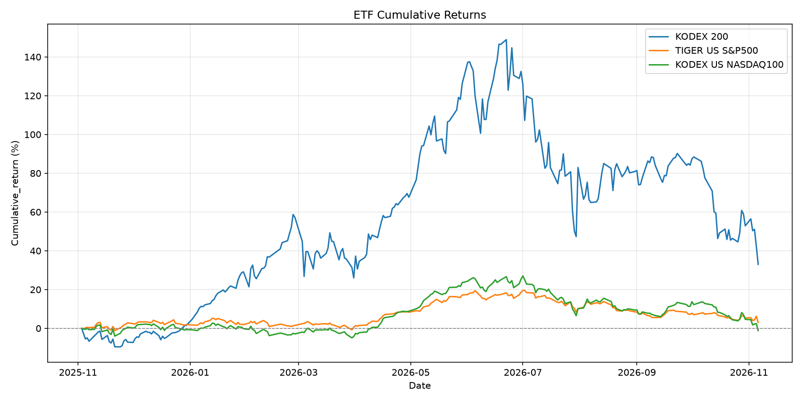
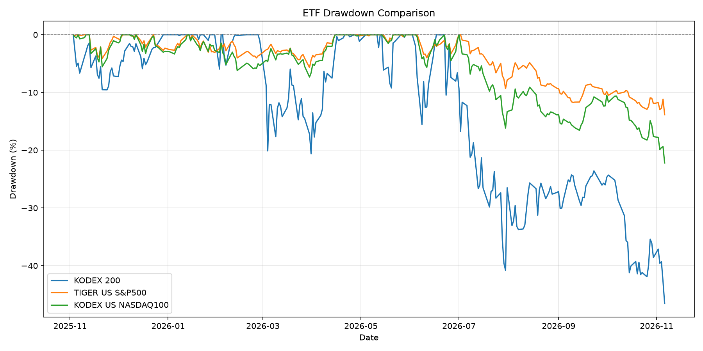

# ETF 성과평가 및 금융데이터 품질관리 프로젝트

## 1. 프로젝트 개요

Python과 SQL을 활용하여 국내 상장 ETF 3종의 가격 데이터를 수집하고, 데이터 품질을 검증한 후 성과 및 위험지표를 비교 분석하는 프로젝트이다.

**프로젝트 목적**
- 금융데이터 수집·저장·검증 프로세스 구현
- ETF 성과 및 위험평가 방법론 학습과 적용
- 데이터 오류 탐지 및 정제 경험 확보
- 금융상품별 위험 대비 성과 비교

## 2. 분석 대상

| ETF | 종목코드 |
|---|---|
| KODEX 200 | 069500.KS |
| TIGER 미국S&P500 | 360750.KS |
| KODEX 미국나스닥100 | 379810.KS |

- 분석 기간: 2025-11-03 ~ 2026-11-06
- 데이터 출처: Yahoo Finance (`yfinance`)
- 사용 기술: Python, pandas, NumPy, SQLite, SQL, Matplotlib

## 3. 프로젝트 수행 과정

### 데이터 수집 및 저장

Python의 `yfinance` 라이브러리를 이용해 ETF 3종의 OHLCV 및 수정종가 데이터를 수집하고 SQLite 데이터베이스에 저장했다.

### 데이터 품질 검증

SQL을 활용해 다음 항목을 검증함.

- 종목별 데이터 건수
- 종목·날짜 기준 중복 데이터
- 결측치 및 비정상 가격
- OHLC 가격의 논리적 일관성
- 날짜 형식 오류
- 종가와 수정종가의 차이

**문제 해결 사례**
DB 추출 후 생성 과정에서 오타 발생하여 코드 오류가 일어남. 오류 원인을 탐색하고 수정하는 과정에서 날짜가 서로 다른 형식으로 저장되어 동일 종목·거래일 데이터가 중복되는 문제를 발견.

SQL을 활용해 날짜 형식 정규화 후 중복 여부를 확인했으며, 동일 거래일의 대응 데이터가 존재하는지 검증한 뒤 중복 행을 정리함.
정제 후 ETF 3종의 총 744개 가격 데이터가 유지되는 것을 확인.

## 4. ETF 성과 및 위험평가

다음 지표를 Python으로 계산.

| 지표 | 설명 |
|---|---|
| 누적수익률 | 분석 기간의 복리 누적 성과 |
| 연율화 변동성 | 일별 수익률의 표준편차를 연간 기준으로 환산 |
| 샤프지수 | 변동성 대비 평균 초과수익 성과 |
| MDD | 과거 최고점 대비 최대 하락폭 |

연율화 변동성 및 샤프지수 계산에는 연간 거래일 252일, 샤프지수의 무위험수익률에는 연 3%를 가정함.

## 5. 분석 결과

| ETF | 누적수익률 | 변동성 | 샤프지수 | MDD |
|---|---:|---:|---:|---:|
| KODEX 200 | 33.01% | 62.84% | 0.73 | -46.56% |
| TIGER 미국S&P500 | 3.00% | 13.63% | 0.07 | -13.85% |
| KODEX 미국나스닥100 | -1.18% | 19.43% | -0.12 | -22.22% |

### 주요 분석 결과

- KODEX 200은 분석 기간 중 가장 높은 누적수익률과 샤프지수를 기록했지만 변동성과 최대낙폭도 가장 컸음.
- TIGER 미국S&P500은 세 ETF 중 가장 낮은 변동성과 최대낙폭을 기록함.
- KODEX 미국나스닥100은 분석 기간의 누적수익률이 음수였으며, 샤프지수도 음수로 나타남.

서로 다른 기초지수를 추종하는 ETF이므로 본 결과를 운용사 간 운용능력의 우열로 해석하지 않았습니다.

## 6. 시각화

### 누적수익률 비교

### 최대낙폭 비교

## 7. 데이터 검증 및 분석 한계

- 분석 결과는 Yahoo Finance에서 수집한 가격 데이터를 기반으로 함.
- 데이터베이스 내부의 중복·결측·가격 논리 검증을 수행했으나, 전체 기간에 대한 독립적인 원천 데이터 대조는 완료하지 않음.
- KODEX 200의 큰 가격 변동은 추가적인 기초지수 및 시장 데이터 비교가 필요함.
- 샤프지수의 무위험수익률 3%는 실습을 위한 가정값임.
- ETF별 보수, 추적오차, 괴리율 및 벤치마크 대비 초과수익률은 평가에 포함하지 않았음. 추후 포함 예정.
- 본 프로젝트는 ETF의 과거 성과를 비교한 것으로 미래 수익률을 예측하지 않음.

## 8. 향후 개선 계획

- ETF 기초지수 및 벤치마크 데이터 연계
- 추적오차와 정보비율 계산
- 데이터 품질 검증 자동화
- 평가 결과 시각화 고도화
- 분석 결과의 재현성 및 검증 체계 강화

## 9. 프로젝트를 통해 학습한 점

금융데이터 분석에서는 지표 계산뿐 아니라 데이터의 정확성과 일관성을 확보하는 과정이 중요하다는 것을 확인함.

특히 날짜 형식 오류와 중복 데이터 문제를 해결하면서, 데이터 수집부터 검증·정제·분석·시각화까지 이어지는 전체 처리 과정을 경험함. 

## 데이터 이상치 검증 사례(추가)

### KODEX 200 (2026-07-31)

일별 수익률이 +20%를 초과한 데이터를 탐지하여
한국거래소(KRX) 자료와 교차 검증했다.

- ETF 시장가격 수익률: +24.17%
- ETF NAV 변동률: +19.97%
- KOSPI 200 지수 변동률: +19.98%
- 당일 시장가격과 NAV의 괴리율: +3.48%

### 검증 결과

ETF의 시장가격 상승은 KOSPI 200 지수 상승과
NAV 증가에 상당 부분 연관되어 있었다.

다만 시장가격 상승률이 NAV 변동률보다 높았으며,
이는 시장가격과 NAV의 괴리율 확대와 관련이 있다.

따라서 해당 데이터를 단순 오류로 판단해 삭제하지 않고,
외부 원천 데이터와 대조한 검증 사례로 기록했다.

출처: 한국거래소(KRX) 정보데이터시스템
https://data.krx.co.kr/

